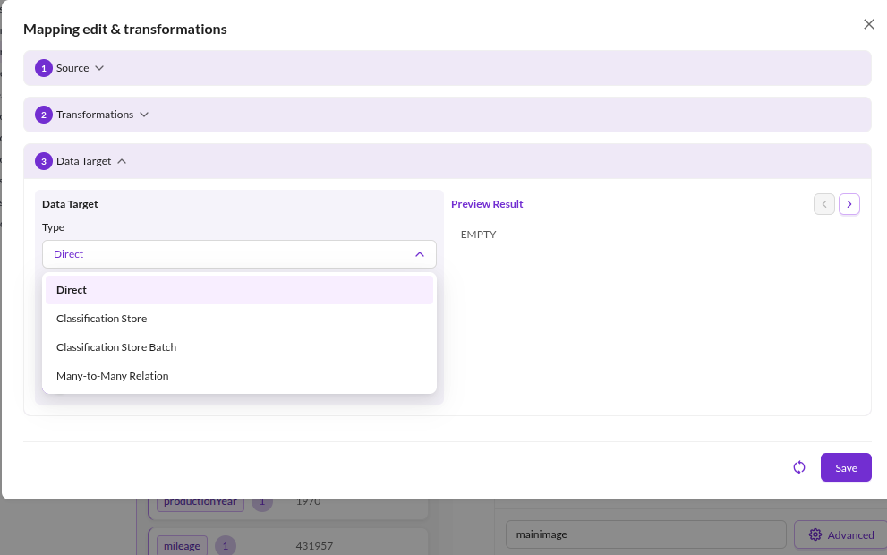
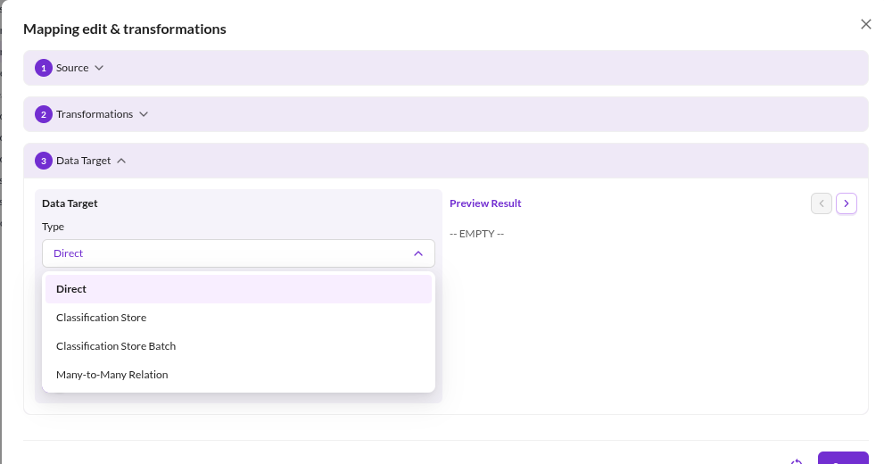
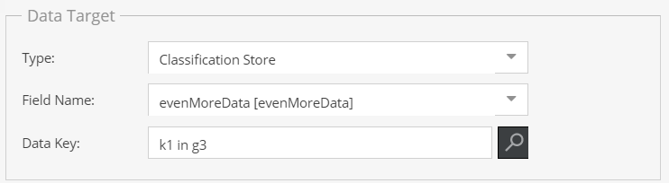
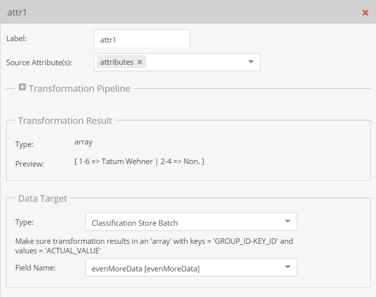

# Data Target

The data target assigns the result of the [transformation pipeline](../01_Transformation_Pipeline.md) to a data object
field. Which fields are selectable depends on the result type the pipeline produces: a pipeline returning a date cannot
be assigned to a text field.

Four data target types are available.

## Direct

Assigns the value to a field of the data object class, to a localized field, or to an object brick field.

Object brick fields are addressed as `<OBJECT_BRICK_FIELD>.<OBJECT_BRICK_TYPE>.<ATTRIBUTE>`. The object key is addressed
as `key`.

The parent folder of the object can be set with the `path` field (**SYSTEM Path**), so the location can be composed
from the import data with the transformation pipeline. The folder structure is created if it does not exist yet.

The mapping is applied after the [resolver](../../04_Resolver_Settings.md) has loaded or created the object, so the
path from the mapping takes precedence over the Element Creation and Element Location Update strategies. Keep a normal
Element Creation strategy (for example `Static Path`) as a fallback: it places new objects whose path value is empty.
For Element Location Update, `No Change` avoids moving the object twice. The parent of an existing variant cannot be
changed; such rows fail with an error.

For `path`, **Write If Target Is Not Empty** refers to whether the object already exists: if disabled, the path is only
applied to newly created objects and existing objects are not moved.

**Configuration options**

- **Field Name**: the target field.
- **Language**: for localized fields, the language to write.
- **Write If Target Is Not Empty**: enabled by default. Disable it to keep an existing value.
- **Write If Source Is Empty**: enabled by default. Disable it to prevent an empty source value from clearing the field.

## Many-to-Many Relation

Assigns related elements to a relation field. Supported field types are `manyToManyRelation`,
`manyToManyObjectRelation`, `advancedManyToManyRelation` and `advancedManyToManyObjectRelation`. Assigning to any other
field type fails with a configuration error.

The transformation pipeline has to produce a result type of `advancedDataObjectArray`, `dataObjectArray`, `assetArray`
or `advancedAssetArray`, typically by ending in a `Load Data Object` or `Load Asset` operator.

**Configuration options**

- **Field Name**, **Language**, **Write If Target Is Not Empty**, **Write If Source Is Empty**: as for `Direct`.
- **Overwrite Mode**:
  - `Replace` (default): the imported relations replace the current ones.
  - `Merge`: the imported relations are added to the current ones. Existing relations are kept, including relations to
    unpublished elements.

## Classification Store

Assigns the value to one key of a classification store field.

**Configuration options**

- **Field Name**: the classification store field.
- **Classification Store Key**: the group and key to write.
- **Language**: for localized keys, the language to write.

## Classification Store Batch

Assigns many classification store keys with a single mapping entry. The transformation pipeline has to produce an array
keyed by `<GROUP_ID>-<KEY_ID>`, with the values to assign.

The result type must be `array`, `quantityValueArray`, `inputQuantityValueArray` or `dateArray`.

For the required data shape and worked examples, see
[Classification Store Batch Details](./01_Classification_Store_Batch_Details.md).
