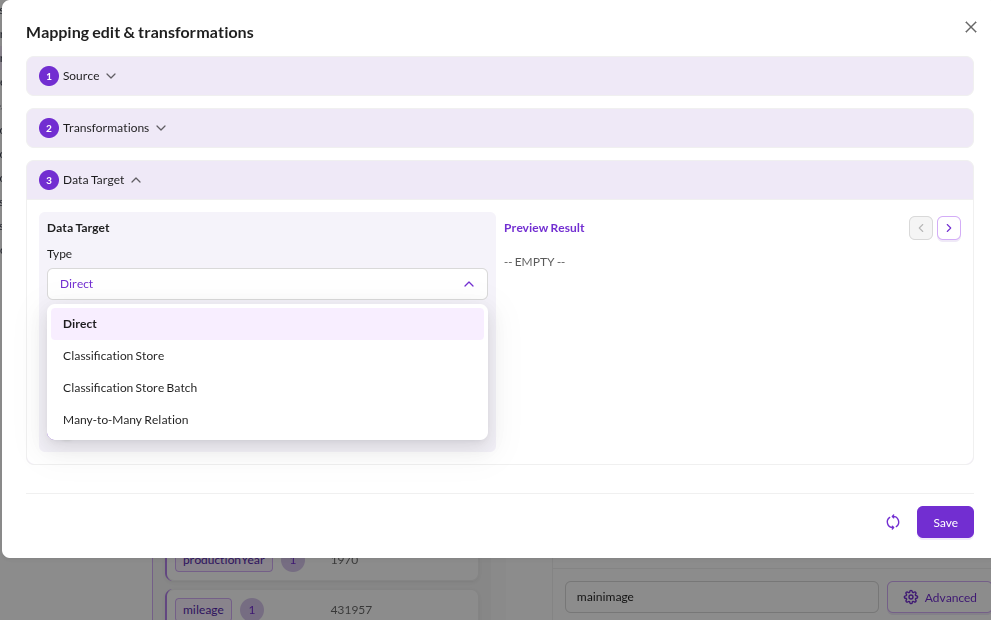
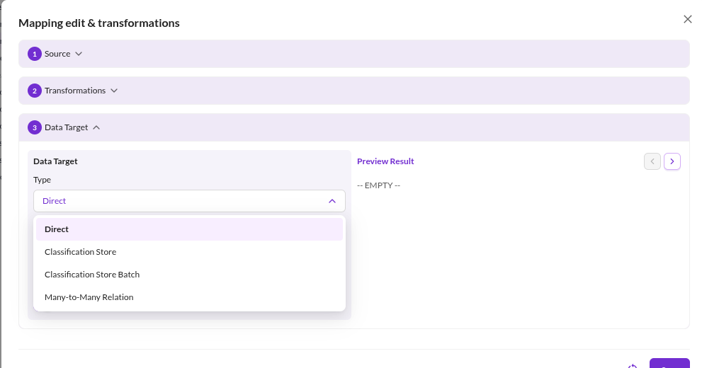
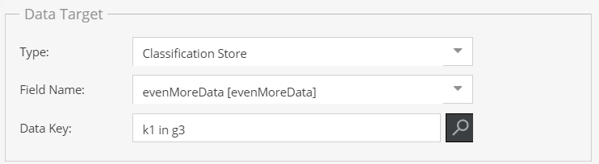
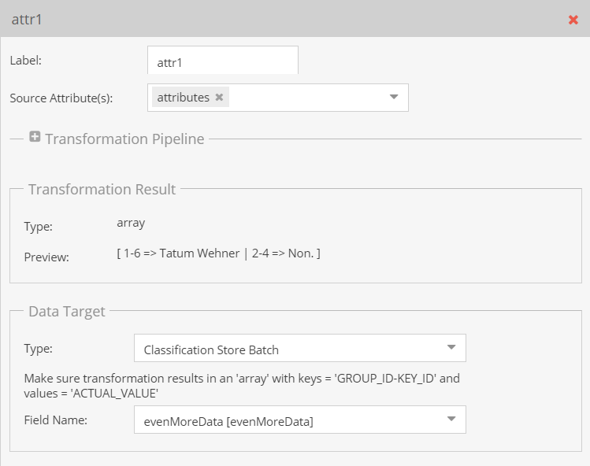

# Data Target

The data target assigns the result of the [transformation pipeline](../01_Transformation_Pipeline.md) to a data object
field. Which fields are selectable depends on the result type the pipeline produces: a pipeline returning a date cannot
be assigned to a text field.

Four data target types are available.

## Direct

Assigns the value to a field of the data object class, to a localized field, or to an object brick field.

Object brick fields are addressed as `<OBJECT_BRICK_FIELD>.<OBJECT_BRICK_TYPE>.<ATTRIBUTE>`. The object key is addressed
as `key`.

**Configuration options**

- **Field Name**: the target field.
- **Language**: for localized fields, the language to write.
- **Write If Target Is Not Empty**: enabled by default. Disable it to keep an existing value.
- **Write If Source Is Empty**: enabled by default. Disable it to prevent an empty source value from clearing the field.

## Many-to-Many Relation

Assigns related elements to a relation field. Supported field types are `manyToManyRelation`,
`manyToManyObjectRelation`, `advancedManyToManyRelation` and `advancedManyToManyObjectRelation`. Assigning to any other
field type fails with a configuration error.

The transformation pipeline has to produce a result type of `advancedDataObjectArray`, `dataObjectArray`, `assetArray`
or `advancedAssetArray`, typically by ending in a `Load Data Object` or `Load Asset` operator.

**Configuration options**

- **Field Name**, **Language**, **Write If Target Is Not Empty**, **Write If Source Is Empty**: as for `Direct`.
- **Overwrite Mode**:
  - `Replace` (default): the imported relations replace the current ones.
  - `Merge`: the imported relations are added to the current ones. Existing relations are kept, including relations to
    unpublished elements.

## Classification Store

Assigns the value to one key of a classification store field.

**Configuration options**

- **Field Name**: the classification store field.
- **Classification Store Key**: the group and key to write.
- **Language**: for localized keys, the language to write.
- **Write If Source Is Empty**: enabled by default. Disable it to prevent an empty source value from clearing the key.
  The setting only takes effect once it has been saved for the mapping entry at least once — see
  [When the setting takes effect](#when-write-if-source-is-empty-takes-effect).

## Classification Store Batch

Assigns many classification store keys with a single mapping entry. The transformation pipeline has to produce an array
keyed by `<GROUP_ID>-<KEY_ID>`, with the values to assign.

The result type must be `array`, `quantityValueArray`, `inputQuantityValueArray` or `dateArray`.

**Configuration options**

- **Field Name**: the classification store field.
- **Language**: for localized keys, the language to write.
- **Write If Source Is Empty**: **disabled** by default, unlike every other data target. Enable it to let an empty
  source value clear the key instead of being dropped. The setting only takes effect once it has been saved for the
  mapping entry at least once — see [When the setting takes effect](#when-write-if-source-is-empty-takes-effect).

For the required data shape and worked examples, see
[Classification Store Batch Details](./01_Classification_Store_Batch_Details.md).

### When Write If Source Is Empty Takes Effect

On the two classification store targets the setting is only in force on a mapping entry for which it has been decided,
which the editor records the first time the control is changed or the target type is selected. Until then the entry
keeps the behaviour it had before the setting reached these targets, whatever its stored value says: the
`Classification Store` target writes every value including empty ones, and `Classification Store Batch` drops every
empty value before writing and does not activate the group of an entry whose values are all empty. Two entries with
identical-looking settings therefore import differently depending on whether that decision has been recorded.

Open the mapping entry, set the control to what the import should do and save the configuration to put it in force.

A value counts as empty when PHP counts it as empty: `null`, `false`, `0`, `0.0`, `"0"`, `""` and `[]`. Note that `0`
is among them.
