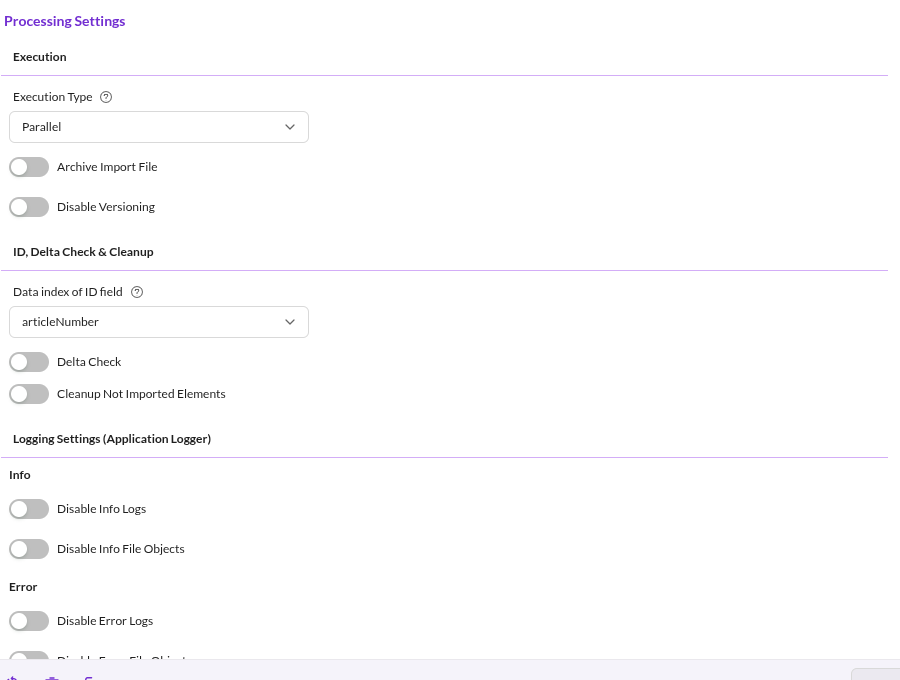

# Processing Settings

Processing settings control how the queued records are processed. They are grouped into execution, identity-based
options, and logging.

## Execution

### Execution Type

- **Sequential**: records are processed one after another, in the order they were queued. Choose this when records depend
  on each other, for example when the import builds a hierarchy.
- **Parallel**: records are processed concurrently. Faster, but the order is not guaranteed.

The two modes are processed by different queue workers. See
[Import Execution Details](../04_Import_Execution_Details.md).

### Stop Import on Error

Stops the import at the first record that fails. Choose this when records depend on each other, for example when a
child record needs the parent record imported before it.

- Disabled (the default): the failing record is logged and the import continues with the next record.
- Enabled: the failing record is logged, and all records and cleanup jobs still queued for this import configuration
  are discarded without being processed. The application logger notes how many queue items were discarded. This entry
  is written even when **Disable Error Logs** is enabled.

A record fails when loading, transforming or saving its element throws an error. A [Cleanup](#cleanup) job fails when
loading the element or running the cleanup strategy throws an error, and stops the import the same way. A record
skipped by a `PreSaveEvent` listener, or one without a matching element under the **Do not create** location strategy,
does not count as failed.

When the import stops:

- The Execution Status shows **Stopped after an error. No import running.** until the next import of the
  configuration starts, for at most seven days.
- Queued cleanup jobs are discarded with the records, so elements are not deleted or unpublished based on an incomplete
  run.
- When a record failed or records were discarded, the [Delta Check](#delta-check) hashes of the import configuration
  are reset. These records passed the delta check when they were queued, so without the reset the next run would skip
  them. The next run processes all records again, including the failing one.
- With the **Parallel** execution type, records that other workers have already started are still finished. The
  number of discarded queue items in the log counts them as well. While such a record is still running, the queue
  already looks empty, so a new import can be started; if that record then fails, it stops the new import.
- The queue holds the records of the import configuration, not of a single run. Records queued by a `Push` data source
  with **Ignore Not Empty Queue** are discarded as well.
- Records are queued while the import is prepared. When a queue worker processes the queue before the preparation has
  finished, for example the cron job running the `process-queue-*` commands during a long import, records queued after
  the stop are still processed.

In the configuration the setting is stored as `processingConfig.stopOnError`.

### Archive Import File

Archives the imported file so the import stays traceable. The importer writes an application logger entry with the
imported file attached as a file object.

Archiving consumes disk space proportional to the imported data. See
[Import Progress and Logging](../05_Import_Progress_and_Logging.md).

### Disable Versioning

Disables Pimcore versioning while an element is saved during the import. Use it when only the final state matters, for
example during an initial data load run by several import configurations in sequence.

Versioning is restored after each element is processed, so the setting does not leak into other operations in the system.

### Version Note

A text that is stored as the note of the version created each time the import saves an element. Every data object the
import creates or updates carries the note on that version, so imported changes can be told apart from manual edits in
the version history, for example `Imported by ERP product feed`.

- Leave the field empty to save versions without a note. This is the default.
- The note is a fixed text. It is the same for every element and every run of the import configuration.
- When **Disable Versioning** is enabled, or versioning is turned off for the element, no version is created and the
  note is not stored anywhere.
- Elements unpublished by [Cleanup](#cleanup) are saved without the note.
- Assets created or overwritten by the **Import Asset** operator of the transformation pipeline are saved without
  the note.

In the configuration the setting is stored as `processingConfig.versionNote`.

## ID, Delta Check and Cleanup

### Data Index of ID Field

The field of the import record that identifies a record across imports. **Delta Check** and **Cleanup** compare records
between runs, so both stay disabled until this field is set.

### Delta Check

Compares the incoming record against a stored hash of the record as it was last seen, and skips it when nothing changed.
This speeds up imports because unchanged records are never queued, so the data object is neither processed nor saved.

Two properties of the checkpoint matter in practice:

- The hash is written during preparation, at the moment the record is queued, not after the record was successfully
  processed. If processing then fails, the hash already reflects the new data. A later run with identical source data
  considers the record unchanged and skips it, so Delta Check does not retry failed records. Re-import them by changing
  the source data, or by disabling Delta Check for one run.
- The comparison covers the import data only. Changes made to the data object in Pimcore between two imports are not
  detected, so a modified object is not restored by the next import.

Computing and storing the hashes costs time and storage. Enable delta check when a large share of records is expected to
be unchanged.

### Cleanup

Removes data objects that exist in Pimcore but are absent from the current import data.

- **Cleanup Not Imported Elements**: activates the cleanup.
- **Cleanup Strategy**: `Unpublish` or `Delete` the affected data objects.

:::warning

Only enable cleanup when every import run is a full import. With partial or delta imports, cleanup deletes or unpublishes
objects that were not part of that run.

:::

Cleanup is queued alongside the import records. See [Import Execution Details](../04_Import_Execution_Details.md).

## Logging Settings (Application Logger)

Large imports can produce enough application logger entries and attached file objects to exhaust disk inodes. These four
switches reduce the volume:

| Setting | Effect |
|---|---|
| **Disable Info Logs** | No info-level application logger entries for this configuration. |
| **Disable Info File Objects** | Info entries are kept, but without the attached source row. |
| **Disable Error Logs** | No error-level application logger entries for this configuration. |
| **Disable Error File Objects** | Error entries are kept, but without the attached source row. |

Disabling logs does not affect the detailed debug output written to the standard Pimcore and Symfony loggers. See
[Import Progress and Logging](../05_Import_Progress_and_Logging.md).
